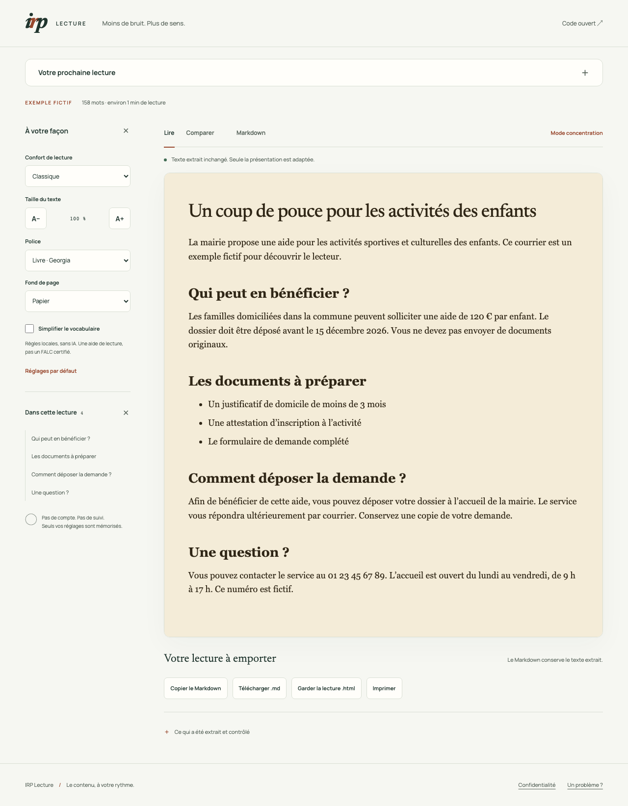

# IRP Lecture

**[Ouvrir le lecteur en ligne](https://irp-lecture.netlify.app)** · Collage et import de fichiers. L’ouverture directe par URL est disponible dans la version locale.

**Faites de la place au texte.** Un lecteur local pour ouvrir une page publique, coller un texte ou importer un fichier, adapter sa présentation et garder une copie lisible hors ligne.



Pas de compte, pas de clé API, pas d’IA nécessaire. Python standard côté serveur, modules JavaScript sans framework côté navigateur.

## Utiliser le lecteur

```sh
./start.sh
# Ouvre http://127.0.0.1:8001/tool
# Autre port, sans ouvrir le navigateur :
./start.sh --port 8767 --no-open
```

Le lancement ne tue aucun processus existant. Ctrl+C arrête le serveur. Le proxy IA de l’ancien prototype est désactivé.

- **Une adresse web** : le serveur récupère une page publique, puis votre navigateur en extrait le contenu. Les sites protégés, authentifiés ou entièrement dynamiques peuvent nécessiter le collage ou l’extension.
- **Un texte à coller** : traitement sur votre appareil. Le HTML collé reste du texte ; utilisez l’import `.html` pour lire un document HTML.
- **Un fichier** : `.txt`, `.md` (titres et listes simples), `.html`. Aucun fichier n’est envoyé au serveur.
- **Un exemple** : fonctionne immédiatement, sans téléchargement de page ou de modèle.

### Lire, comparer, garder

Le texte extrait est affiché **sans reformulation par défaut**. Choisissez une police, un fond, un profil espacé ou à contraste élevé, et la taille du texte. Les réglages sont conservés localement ; les documents ne le sont pas.

Le sommaire mène aux sections. Le mode concentration masque les réglages ; Échap les restaure. La simplification du vocabulaire est une option explicite par règles locales. **Comparer** présente le texte extrait et la version de lecture, avec les passages modifiés signalés.

- **Markdown** : copie ou téléchargement du texte extrait, sans simplification, utile aussi aux agents IA.
- **Lecture `.html`** : copie de la version affichée, styles inclus, sans script ni ressource distante. À rouvrir même sans connexion.
- **Imprimer** : seule la lecture est imprimée.
- **Copier le lien** : disponible pour les pages publiques. Le destinataire récupère à nouveau la page ; ce n’est pas un instantané.

## Extension navigateur

Pour lire la page déjà ouverte, y compris son contenu chargé dynamiquement :

```sh
python3 scripts/build_reader.py
```

Dans `chrome://extensions`, activez le mode développeur, puis chargez le dossier `dist/irp-reader/`. Cliquez sur l’extension, puis **Lire cette page**. Le raccourci proposé est Alt+Maj+L. Les permissions sont `activeTab`, `scripting` et `storage`, sans accès permanent aux sites.

L’extension propose les profils de lecture, le texte extrait sans reformulation, l’export Markdown et une copie HTML. L’IA locale reste expérimentale et nécessite une API disponible dans le navigateur ; le lecteur fonctionne sans elle. Le paquet du Web Store est produit dans `dist/`. Sa génération ne le publie pas.

## Ce que les contrôles garantissent — et leurs limites

Le rendu est déterministe : aucun HTML produit par un modèle dans le chemin IRP-Doc. L’import HTML est analysé dans un template inerte ; les scripts et gestionnaires d’événements sont retirés avant extraction. Les images distantes ne sont pas chargées par le lecteur.

Les contrôles recherchent des nombres, symboles monétaires et noms repérés dans le **texte extrait**. Les reformulations sont aussi filtrées sur les marqueurs de négation, condition, modalité et ordre temporel. Une sortie refusée retombe sur les règles conservatrices ou sur l’original.

**Ce sont des heuristiques, pas une preuve d’équivalence du sens.** Elles peuvent produire des faux positifs ou manquer une altération. L’extraction peut omettre du contenu. Un `must_show` présent dans le texte ne prouve pas qu’il soit associé au bon objet. Les formulaires et médias ne sont pas reproduits. Gardez accès à la source pour vérifier une information importante.

Le langage simplifié est une **aide de lecture**, pas un FALC certifié. Les contrôles automatisés d’accessibilité ne remplacent pas un audit ni des essais avec des utilisateurs.

## Vérifier

```sh
# Dépendances de test uniquement ; aucun npm nécessaire pour utiliser le lecteur
npm ci --prefix tests
bash scripts/sync-core.sh
(cd tests && node --test)
python3 -m unittest discover -s tests -p 'test_*.py'
# Avec ./start.sh déjà lancé dans un autre terminal :
python3 tests/e2e_test.py
python3 scripts/build_reader.py
python3 scripts/build_site.py
```

Pour les essais navigateur (dépendances de développement uniquement) :

```sh
(cd tests && npx playwright install chromium)
npm run --prefix tests test:browser
```

Pour la matrice responsive dans Chromium, Firefox et WebKit :

```sh
(cd tests && npx playwright install firefox webkit)
npm run --prefix tests test:responsive
```

Elle vérifie 16 formats (320 à 2 560 px, portrait et paysage), les vues Lire/Comparer/Markdown, les grands caractères et les données larges. Les résultats sont enregistrés dans `docs/responsive-results.json`.

Cette commande lance et arrête ses propres serveurs et teste aussi le vrai paquet d’extension dans un profil temporaire.

`tests/reader.browser.js` contient un scénario Playwright complet : clavier, mobile, axe-core dans Chromium, comparaison, téléchargement et relecture hors réseau, concurrence entre URL et collage, import hostile et quatre pages publiques réelles. Son en-tête indique les serveurs nécessaires. Le bilan daté est dans [docs/VALIDATION.md](docs/VALIDATION.md).

Le benchmark historique de 20 pages **synthétiques** est dans [bench/REPORT.md](bench/REPORT.md). Ses chiffres ne décrivent ni le web réel ni une certification. Les essais sur pages réelles ne constituent pas une mesure statistique de fidélité ou de compréhension.

## Déployer une version statique

```sh
python3 scripts/build_site.py
# Publier dist-site/ sur un hébergement statique
```

Le collage, les imports, les réglages et les exports fonctionnent sans backend. La version statique ouvre le collage par défaut et explique la disponibilité de l’ouverture par adresse avant toute tentative. **La récupération d’URL demande le serveur Python** ; si elle manque, le lecteur propose le collage. Un hébergement compatible avec `_headers` applique les en-têtes fournis.

Pour rendre la récupération d’URL accessible hors loopback, le serveur exige `--fetch`. Le fetcher refuse les réseaux privés, les ports non standards et les redirections vers un réseau privé, épingle l’IP validée et borne les téléchargements. Ne désactivez pas ces protections pour contourner un site bloqué.

## Architecture

| Dossier | Rôle |
|---|---|
| `irp-core/` | Source canonique : format IRP-Doc, extraction, rendu, adaptation, vérification, Markdown, utilitaires de lecture |
| `irp-site/tool.*` | Application de lecture |
| `irp-extension/reader.js` | Lecteur intégré à la page, également utilisé par le widget |
| `irp-reader/` | Extension minimale à empaqueter |
| `irp-server/` | Serveur Python, récupération publique et routes agent |
| `irp-spec/irp-doc-v1.0.md` | Format de contenu IRP-Doc |
| `irp-client/`, `irp-sdk/` | Ancien prototype à intentions et SDK ; expérimental |

Après toute modification du cœur, `scripts/sync-core.sh` synchronise les copies du client et de l’extension. `scripts/build_reader.py` embarque les mêmes sources dans le paquet.

Le serveur conserve aussi les vues agent `.md`, `.irpdoc.json`, `/llms.txt` et `/.well-known/irp.json`, ainsi que la démonstration locale `/local`. Ces chemins ne sont pas nécessaires à la lecture courante.

Licence MIT.
